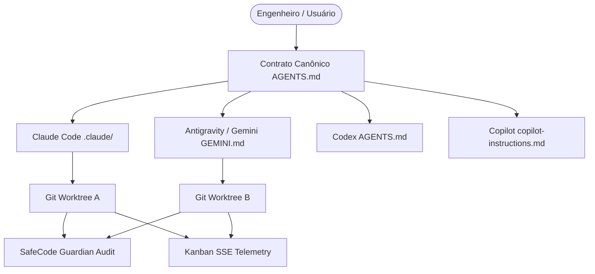

# Arquitetura do Multi-Harness Starter Pack

## Visão Geral
O Multi-Harness Starter Pack é um framework de engenharia de software para projetos desenvolvidos colaborativamente por múltiplos agentes de inteligência artificial (Claude Code, Google Antigravity/Gemini, OpenAI Codex, GitHub Copilot).

## Limites de Confiança e Fronteiras de Segurança
1. **Fronteira de Código vs. Segredos:** Arquivos `.env*`, chaves privadas (`.pem`, `.key`, `id_rsa`) e credenciais de cloud jamais entram no repositório. O hook `block-secrets.sh` e `pre-commit-secrets.sh` interceptam leituras e commits no nível da ferramenta.
2. **Fronteira de Processos Paralelos:** Cada agente opera em seu próprio Git Worktree isolado. Mudanças só chegam à branch principal via Pull Request ou revisão formal pós-validação de gates (`make verify`).
3. **Fronteira de Telemetria:** O board local (`server.mjs`) expõe eventos SSE efêmeros em `127.0.0.1` e não transmite código para a internet.
4. **Fronteira de Memória Persistente:** A integração opcional com o Fulltech Memory MCP armazena apenas decisões duráveis e arquiteturais, sem logs brutos ou segredos.

## Modelo de Ameaças & Diretrizes Evertec
- **Injeção de Código e SQLi:** Todas as operações com banco devem utilizar consultas parametrizadas (Prepared Statements).
- **Validação no Backend:** Toda entrada de usuário ou cliente externo é tratada como não confiável e validada no backend via esquemas estritos (Pydantic, Zod, etc.).
- **Rate Limiting e CORS:** APIs expostas implementam limites de requisição e políticas restritivas de origem.
- **Erros e Logs:** Stack traces completos são restritos a logs internos protegidos; usuários recebem apenas mensagens genéricas e seguras.
